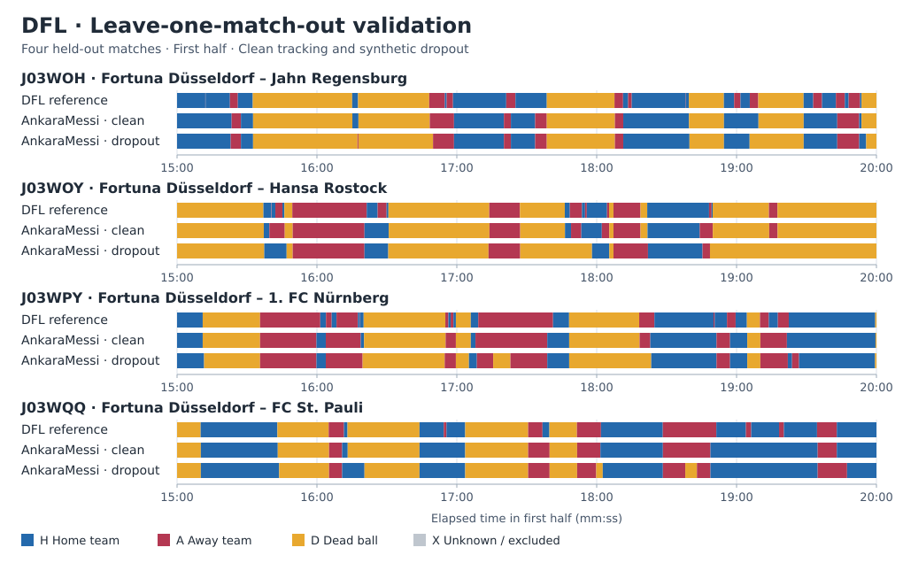
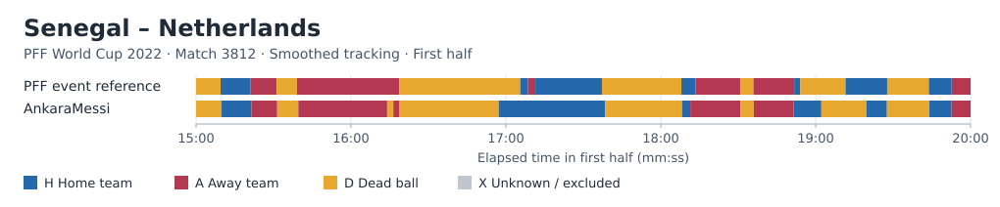
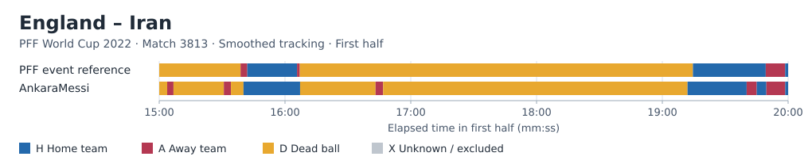
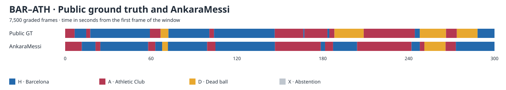

# AnkaraMessi — Team possession from tactical tracking

More than a Hack 2027, Phase 1: ball possession

**Team members:** Matteo Tognetti, Carlo Borghini, Pietro Borracelli and Christian Petani

**Repository:** https://github.com/Cmkjo/AnkaraMessi

## Development objective and protocol

AnkaraMessi predicts H (Barcelona), A (Athletic Club) or D (dead ball) for each in-half tactical video frame, and X outside the published half intervals. The central problem is temporal structure. Nearest-player estimates fluctuate in challenges, while long majority windows merge genuine changes of control. We therefore combine geometric and kinematic evidence with sequence decoding, then refine ownership within the live intervals.

All fitted parameters come from four external DFL matches. Candidate development used external leave-one-match-out and PFF transfer checks. The configuration, external fit and dependency hashes were frozen before the public diagnostic was run.

**The public BAR–ATH ground truth was used after freezing for a pipeline diagnostic. It was not used to tune parameters.** The published diagnostic is the result of the final frozen candidate. The target-game video and ground truth are absent from the inference and training entry points. [Challenge rules](https://github.com/metrica-sports/more-than-a-hack-2027/blob/main/RULES.md)

## External assets and label provenance

| Source | Content and role | Licence or access |
|---|---|---|
| DFL integrated dataset | Tracking, match metadata and event XML. Four matches provide training labels and fitted weights. | CC BY 4.0. [Dataset](https://doi.org/10.6084/m9.figshare.28196177) |
| PFF World Cup 2022 | Smoothed tracking for games 3812–3816, metadata and rosters. Transfer evaluation only. | Access through the provider's dataset request process. [Access announcement](https://www.blog.fc.pff.com/blog/pff-fc-release-2022-world-cup-data) |
| SkillCorner Open Data | Six games used for an adaptation experiment and detected-versus-extrapolated tracking audit. Excluded from the released fit. | MIT repository. Credit SkillCorner and PySport. [Source](https://github.com/SkillCorner/opendata) |
| Metrica Sample Game 3 | External EPTS layout and identity-reader tests. No training labels or final fit derived from it. | Provider sample. [Source](https://github.com/metrica-sports/sample-data) |

The training games are J03WOH, J03WOY, J03WPY and J03WQQ, comprising 568,306 frames and 1,680 reference spells. BallStatus and BallPossession are supplied fields of the official DFL collection, rather than labels produced by our team. The authors describe operator annotations, tracking acquisition and processing. We do not claim that each frame was independently hand-labelled. The separate DFL event logs do not enter the released fit. [Bassek, Rein, Weber and Memmert, dataset description](https://doi.org/10.1038/s41597-025-04505-y)

PFF ownership and live/dead references are reconstructed from provider event associations. Those events are provider-produced annotations, not team-created frame-level ground truth. Their exact human-versus-automatic production is not established in the access announcement. Unknown or conflicting states are excluded from scoring. Events never enter the prediction features. We obtained our working copy through a shared Google Drive folder and used it only for external evaluation. Organisers can request access through the form referenced in PFF FC's release announcement and follow the provider's download instructions. The announcement does not state a public data licence. Any terms supplied during access must be retained with the team's access records; the data are excluded from this repository. Training and submission inference do not require PFF.

## Construction of the model

Initial experiments combined nearest-team distance with Gaussian HMM evidence. A logistic residual using distance contrast, relative speed and their interaction improved ownership decisions. Local activity and team shape then improved robustness when the ball disappeared. A complete activity/context/control fusion increased DFL clean spell F1 from 0.44318 to 0.50498, and the first two-game PFF smoothed comparison from 0.48887 to 0.56257.

We subsequently observed excessive merging of live ownership intervals. The final refinement estimates relative team control over a short window while preserving the base model's D mask. Full live/dead replacement, duration models and deterministic restart or boundary corrections did not transfer consistently. Their weights and overrides are excluded from the release.

## Mathematical implementation

Let $d_T(t)$ denote the nearest observed player distance to the ball for team $T$. Relative speed is the norm of the difference between player and ball velocity vectors. Velocities use a centred least-squares slope over five consecutive native frames. Missing windows are invalid. The base motion branch also rejects peaks above externally fitted quantiles.

The base HMM combines nearest distances, distance contrast, player and ball activity, and signed pitch-boundary distance. Missing Gaussian dimensions contribute no evidence. Viterbi runs at 5 Hz:

$$
V_t(j)=\ell_t(j)+\max_i\bigl[V_{t-1}(i)+\log P_{ij}\bigr].
$$

The H/A residual uses log-distance contrast, log-relative-speed contrast and their interaction. For base live log mass $L=\log\bigl(e^{\ell_H}+e^{\ell_A}\bigr)$ and corrected odds $z=\ell_H-\ell_A+\Delta$, new emissions are $L+\log\sigma(z)$ and $L+\log\sigma(-z)$. This preserves live mass. A separate fitted head changes D evidence. [Rabiner, HMM tutorial and Viterbi decoding](https://doi.org/10.1109/5.18626)

Context features include mean speed within 12 m of the ball, collective speed, team centre and dispersion, a geometric goalkeeper proxy, and observed exit/re-entry anchors around ball gaps. The goalkeeper proxy identifies a deep player in the penalty area with compatible ball proximity and motion, without asserting player identity. The gap evidence decays with elapsed time using the external median dead-ball duration. Unanchored missing ball alone does not imply D.

The ownership refinement uses the best per-team control quality

$$
q_i(t)=\exp\Bigl[-\tfrac12\bigl(d_i/\sigma_d\bigr)^2-\tfrac12\bigl(r_i/\sigma_v\bigr)^2\Bigr],
\qquad Q_T(t)=\max_{i\in T}q_i(t).
$$

Features comprise signed distance contrast, $Q_H-Q_A$, and a signed interaction at five offsets between $-1.2$ and $+1.2$ s, plus centred means. Team swapping reverses their signs. A symmetric, zero-intercept logistic classifier is fitted on external alive labels. Binary Viterbi assigns H/A inside the fixed live intervals. When all relative features are missing, the base ownership evidence is used. Predictions are expanded to native video frames. The method is offline.

## Possession conventions and target-game assets

**Loose balls and passes.** Proximity, velocity agreement and transition persistence support team continuity during travel. Airborne-ball height is not modelled, which can cause ambiguous nearest-player evidence.

**Challenges.** The local team contrast can reverse ownership when the opponent has sustained stronger proximity and speed agreement. It does not label every nearest-player fluctuation as a turnover.

**Restarts and dead ball.** D is inferred from base geometry, activity, control and gap context. The final ownership refinement cannot change D. The system does not use referee events or manually corrected target-game timestamps. A goalkeeper holding the ball can remain live through the geometric/context evidence.

**Inputs used.** Only tactical ATD TXT and XML are required for inference. Homography is unnecessary because tracking is already in pitch coordinates. Tactical and broadcast video are excluded from the released algorithm. Smart Tagging was explored as fallible automatic restart evidence, but the released path does not use it. Broadcast has a separate timeline. [Official asset definitions](https://github.com/metrica-sports/more-than-a-hack-2027/blob/main/DATA.md)

## Parameter provenance

| Parameters | Origin and purpose |
|---|---|
| Means, variances, initial state, transitions, logistic coefficients and RMS scales | Fitted exclusively on the four DFL training matches. LOMO excludes the entire held match; team-context teachers exclude the pseudo-label recipient as well. |
| Peak-motion limits and base control scales | 99.5th percentile peak caps and 25th percentile proximity/relative-speed scales from DFL. Base control scales are approximately 0.732 m and 1.185 m/s. |
| Gap decay | Median DFL dead-ball duration, 19.4 s in the final fit. |
| 12 m activity radius, minimum two activity observations, five players for shape | Fixed neighbourhood and coverage assumptions tested externally. |
| Ownership scales 1.4 m and 3.2 m/s | Fixed soft proximity and velocity-agreement assumptions declared before the external experiment. A deviation equal to one scale contributes a factor of about 0.61. No scale grid was fitted to public labels. |
| Ownership window ±1.2 s and means of 5/13 bins | Fixed local temporal context, validated as part of the external candidate. |
| L2 0.001, variance floor 10⁻⁶, unit transition pseudo-count | Fixed regularisation and numerical stability choices. |
| Base clips ±3 H/A and ±8 D; control-change lookback 0.4 s | Bounded evidence and short-term motion-agreement assumptions. |
| Base merge ≤1.5 s, opponent distance >3 m and ≥80% observed | External-tested removal of unsupported brief ownership islands. It is not reapplied after ownership refinement. |
| Native units and half bounds | Published data contract. Speed numbers are interpreted as m/s as described in DATA.md, despite the XML unit label. The preserved numerical conversion round trip reproduces the frozen CSV. Input hashes are release-integrity checks in the manifest, not a match-identity inference gate. |

## Evaluation and limitations

| Bank | AnkaraMessi spell F1 | AnkaraMessi macro F1 | Smoothed nearest spell F1 | Smoothed nearest macro F1 |
|---|---:|---:|---:|---:|
| DFL clean, LOMO | 0.53164 | 0.90236 | 0.46224 | 0.87636 |
| DFL synthetic dropout | 0.44583 | 0.86051 | 0.32391 | 0.77099 |
| PFF smoothed, five games | 0.62232 | 0.88804 | 0.52239 | 0.88414 |
| BAR–ATH public diagnostic | 0.514286 | 0.707903 | 0.424242 | 0.581185 |

The external comparators are format-adapted five-second nearest-player baselines. DFL uses an externally fitted D detector; PFF inherits D from an earlier HMM and uses 149 frames at 29.97 Hz. BAR–ATH uses the official smooth125 file. The published full-match floor is smooth50 at 0.2433 spell F1; public-window rankings do not establish hidden full-match rankings. [Evaluation specification](https://github.com/metrica-sports/more-than-a-hack-2027/blob/main/EVALUATION.md)

Figures 1 and 2 illustrate the external validation with excerpts chosen by a fixed rule: all four DFL development folds and the two matches of the initial PFF transfer evaluation, each shown from 15 to 20 minutes after the first frame of the first half, rounded to native frame boundaries. The aggregate scores above use the full evaluation sets. On DFL, every panel is predicted by the fold model fitted on the other three matches, so it is out of sample even though all four matches belong to the final training set. On PFF, the frozen release model is applied without any fitting. Most predicted spells align with the reference. The visible errors are very short reference spells merged into the surrounding possession, shifted dead-ball boundaries (more frequent under synthetic dropout) and, in match 3813, brief spurious possessions inside long stoppages.

*Figure 1. DFL leave-one-match-out validation. Each panel compares the DFL `BallStatus`/`BallPossession` reference with AnkaraMessi predictions on clean tracking and on the same tracking with synthetic dropout. The model for each panel was fitted on the other three matches. All panels show minutes 15:00–20:00 of the first half and use the same dropout scenario (`dropout_20261102`, the first of the three used for the aggregate comparison).*

*Figure 2. PFF FC World Cup 2022 transfer evaluation, minutes 15:00–20:00 of the first half. **Top:** 3812, Senegal vs Netherlands. **Bottom:** 3813, England vs Iran. AnkaraMessi predictions on smoothed tracking are compared with the possession and dead-ball reference derived from PFF events; X marks states excluded from scoring. The model was fitted on DFL data and evaluated on PFF to assess transfer across providers. In 3813 the long dead-ball interval shows how the model handles brief live predictions within a stoppage.*

The frozen public prediction has 18 spells against 17 reference spells and recognises 470 of 1,469 D frames. Dead-ball recall is about 0.32. The ownership refinement improves external spell structure but does not address those D errors. The four DFL training games share a recurring team, PFF uses event-derived labels, and the public sample is small. The PFF transfer check runs on PFF's smoothed tracking stream, which is cleaner and more continuous than the automatic ATD of the target match, so its scores are likely optimistic for BAR–ATH.

*Figure 3. BAR–ATH public window (7,500 graded frames): published reference and the frozen AnkaraMessi prediction. Post-freeze pipeline diagnostic only; it was not used to tune or select anything.*

Figure 3 contains only the published public reference labels and algorithmic predictions, without tracking coordinates, video frames or private labels. Figures 1 and 2 likewise show only labels, with no tracking data.

**With more time.** Dead-ball detection is the main weakness, so most of the next steps target it:

- *Missing-ball stretches as dead-ball evidence.* Model each stretch without a ball position from its length, where the ball was last and next seen (outside the pitch or near a line) and how fast the players move, instead of relying only on anchors around the gap.
- *Stronger use of Smart Tagging.* Set-piece tags mark windows that certainly contain a stoppage and a restart. Giving them more weight as soft D evidence, from the start of the tag to the estimated restart, and using the tagged team for the restarting side, would address the low D recall. The gain would first be measured on external restarts.
- *Short possessions.* A contact detector using ball height and player–ball velocity agreement, to separate a controlled reception from a touch or a deflection, as the challenge definition requires.
- *A validation closer to the target.* Raw rather than smoothed external tracking, degraded to anonymous, fragmented tracks like the ATD, and scored against both provider ownership and a controlled-possession relabelling, to measure how sensitive the model is to the possession definition.

## Reproduction, training audit and development assistance

See the [repository README](https://github.com/Cmkjo/AnkaraMessi/blob/main/ankaramessi/README.md) for inference, validation, training and nested LOMO commands. The release CSV has 199,319 data rows. Expected SHA-256: `8d31ea61c78d059de2bff86116ab1692727c30ff5eb588a058ca105d92cdcbdc`. The training recipe pins external DFL input hashes and reconstructs the distributed parameter values. PFF access is optional for the separate transfer validator.

Hosted language-model assistance was used for development, code review and technical writing. We did not supply any challenge data or extracts to hosted LLMs. The inference is local Python/NumPy. [FAQ on permitted assistance](https://github.com/metrica-sports/more-than-a-hack-2027/blob/main/FAQ.md)
